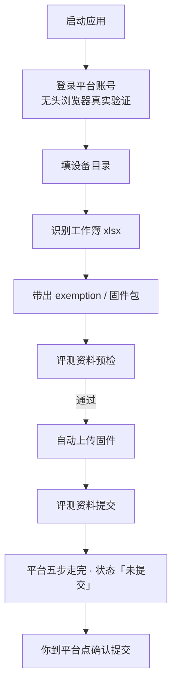
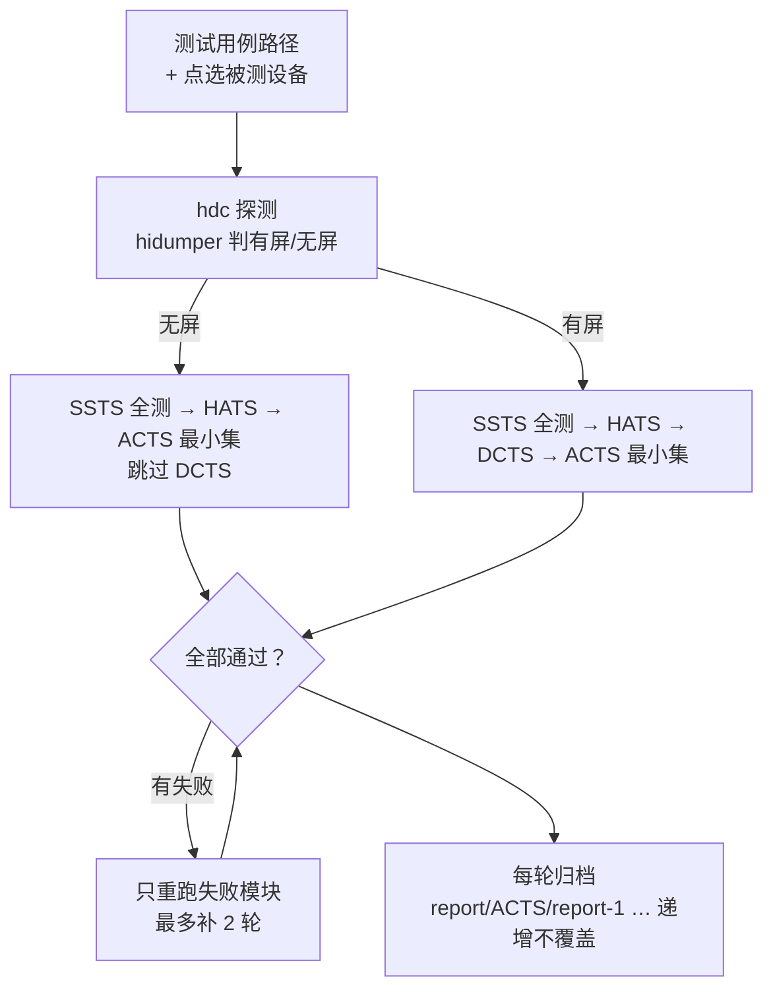

# OpenHarmony XTS 报告上传（桌面版）

把一台设备的 **第二阶段评测资料**、**豁免资料草稿**、**固件镜像** 交给平台，不用手动点完 5 步。独立 Windows 桌面应用，不依赖 DSH Desktop。

- 登录平台账号 → 自动记住（本机加密），下次免输密码
- 填一个设备目录 → 自动带出工作簿、`exemption/`、固件包路径
- 预检通过 → 自动上传固件（平台已有同名固件就跳过）
- 提交 → 联系人 / 产品定义 / 软件定义 / 报告上传 / 样机寄送，一路保存到「未提交」
- XTS 串行自动测试 → 失败自动补测 → 报告归档成 `report-1、report-2 …`

> 只**保存草稿**，从不代你点「确认提交」；豁免资料同理，只存草稿。



## 三步上手

### ① 登录平台账号

启动即见登录页：填**兼容性测评平台账号密码**，应用会用无头浏览器真实登录平台验证一次（密码错误当场报错，不会存错凭据），通过后进入主界面。

勾选「记住密码」（默认开）：验证通过后账号密码用 DPAPI 加密存到本机，下次启动**点选账号免输密码直接登录**；可存多个账号，登录页下拉选择，不需要的账号可删除。

侧边栏底部「退出账号」只清凭据，设备目录/测试配置保留——换平台账号提交时用。

### ② 填设备目录 → 预检 → 提交

只填**目录**，工作簿按目录里的 `OpenHarmony兼容性申请资料.xlsx` 自动识别；同时带出豁免路径、固件包路径（不会自动提交）。

1. 「设备目录（或批量父目录）」填设备目录，例如 `D:\ohos\XTS6.1\<项目>\<设备目录>`
2. 带出后直接点「评测资料预检」——预检会做三件事：旧版式工作簿就地升级、`report/` 自动压成 `report/report.zip`、校验外观图与 `pcid.sc`
3. 预检通过后点「评测资料提交」：联系人 / 产品定义 / 软件定义 / 报告上传 / 样机寄送，五步走完状态是「未提交」，`确认提交` 仍由你在平台上点

平台要求「考过准入考试才能提交」，插件在创建/推进申请之前就自己处理（内置 56 题题库）。

### ③ 未提交草稿

填了目录就会自动查一遍：这个目录下创建过哪些平台申请、哪条能直接续提交。

1. 点「评测资料提交」会**继续**这条申请，不会重新建一条
2. 废稿（考试闸门卡死、平台 404）点「解除关联」→「确认解除」：只清掉本机工作簿里的申请标识/测评编号，平台上的旧申请**不动**
3. 在平台上点完「确认提交」后，面板会一直显示未提交——点「**平台核验**」登录平台逐条核对真实状态并回写工作簿：平台已完成的自动从面板消失

## 测试盒子

「测试盒子」页只管一件事：确认盒子在线。

1. 填盒子地址——**SN（USB）** 或 **IP:Port（网络）**，应用自动识别类型
2. 绿点 = 在线（USB 即插即用；网络走 `hdc tconn`，后续支持）
3. DCTS 前会自动触发盒子与被测设备的配网（拉起 dcct → 人工配对 → 连接确认），无需在此页手动操作

## XTS 自动测试

不想再手跑 xdevice？「XTS 自动测试」页把四套用例串行跑完、判卷、补测、归档，一条龙。



1. 「测试用例路径」填 xts-acts 套件根目录（下含 `ssts/ hats/ dcts/ acts/`）；「被测设备」从**空闲设备列表点选**（可多选，HATS / ACTS 套件内多设备并行）
2. **SSTS 与 DCTS 固定单机执行**（自动取第一台 SN）；DCTS 首轮会自动执行套件 `resource\dcts_resource.bat` 安装测试工具——bat 会重启设备，等它回线后才继续
3. **DCTS 前置配网**：跑到 DCTS 时自动触发盒子连通预检（在线 / 同网段 / ping / 拉起 dcct）→ 人工在盒子上配对（勾 Wi-Fi → 允许被发现 → 点击目标 → 永远信任 → 输 PIN）→ dcct 显示被测设备后自动开测；超时 5 分钟跳过 DCTS
4. 面板里四段流水线逐套件推进，总体进度 + 预计剩余时间滚动修正；有失败只重跑失败模块（上限 2 轮），仍失败的标红等你人工处理或走豁免
5. 每轮 xdevice 报告**完整归档**到「设备目录」的 `report\<ACTS|HATS|DCTS|SSTS>\report-1、report-2 …`，编号递增不覆盖，正好接上预检→提交链路

环境要求：样机保持 hdc 在线，`python`（装好 xdevice）与 `hdc` 在 PATH；DCTS 还需要**测试盒子**（SN 或 IP，在「测试盒子」页填写）。测试直接调 `python -m xdevice`，跳过 `run.bat` 每次的 pip 重装；最小集清单走 `-tf` 文件，绕开 Windows 32KB 命令行上限。

## 交了什么给平台

| 平台要的 | 从哪来 |
|---|---|
| 产品 / 软件定义、安全补丁、版本Id | 工作簿「产品定义」「软件定义」段 |
| 镜像文件 | 设备目录里的 `*.7z` / `*.zip`（上传前查重，同名跳过） |
| XTS 报告 | `report/report.zip`（没有就自动把 `report/` 打包） |
| PCS 自检表 | 目录里的 `OpenHarmony设备兼容性规范*自检表_标准系统.xlsx` |
| 外观图 / PCID.sc | 目录里的图片与 `pcid.sc` |
| 快递单号 / 物品清单 | 工作簿「快递单号」+ 目录里的样品清单 xlsx（选填） |

## 豁免资料

1. 点「识别目录」只读不写：列出每个模块的测试套、用例数、平台提交路径与附件
2. 「保存豁免草稿」才真正登录平台存草稿；任一条失败即停；绝不调用提交接口

## 出错先看这一块

失败原因直接写进面板，例如：登录失败、平台已有重复设备申请、镜像文件被删导致平台 500。按提示处理后重试即可，进度条会说明停在哪一步。

## 提交文件结构

```text
D:\ohos\XTS6.1\<项目>\<设备目录>
├─ OpenHarmony兼容性申请资料.xlsx                   # 必需 · 产品定义 / 软件定义 / 快递单号
├─ OpenHarmony设备兼容性规范6.x自检表_标准系统.xlsx # 必需 · PCS 自检表
├─ <设备目录>-20261106.7z                           # 必需 · 固件包（.7z / .zip）
├─ <设备目录>.png                                   # 必需 · 外观图（纯白背景）
├─ pcid.sc                                          # 必需 · 标准系统 / 小型系统
├─ OpenHarmony兼容性测试样品清单.xlsx               # 可选 · 样机寄送物品清单
├─ report/
│  ├─ report.zip                                    # 必需 · XTS 报告
│  └─ ACTS/ · HATS/ · DCTS/ · SSTS/                 # 「XTS自动测试」逐套件逐轮归档
│     ├─ report-1/                                  # 第 1 轮完整 xdevice 报告
│     └─ report-2/ …                                # 补测轮；编号递增不覆盖
└─ exemption/                                       # 可选 · 豁免资料（独立链路）
   ├─ Acts/<模块名>/<套件>.txt                      # 报告 + 豁免理由
   └─ Hats/ · Dcts/ · Ssts/                         # 结构同 Acts
```

## 安装

<details>
<summary>构建并运行（点开）</summary>

```bash
npm install
npm run app        # 构建并启动
npm run build      # 仅构建（渲染进程 vite + 主进程 tsc）
```

前置：Node.js ≥ 20（npm install 会自动下载 Electron）；XTS 自动测试还需要 `python`（装好 xdevice）与 `hdc` 在 PATH。

首次启动会显示登录页，填平台账号密码即可。
</details>

<details>
<summary>桌面快捷方式（点开）</summary>

构建完成后，手动在桌面创建快捷方式指向 `node_modules\electron\dist\electron.exe`，参数填项目根目录（`D:\ohos\xts-reporter-app`）即可双击启动。后续可加 electron-builder 打包成免安装目录/安装包。
</details>

## 更多

<details>
<summary>架构、接口与安全边界（点开）</summary>

- **架构**：Electron 主进程内起 `127.0.0.1` 随机端口本地 API 服务；数据面从插件 `phase2-routes.ts` 1:1 移植。渲染进程 Vite + React + TS，侧边栏七页（概览 / 测试盒子 / 评测资料 / XTS 自动测试 / 镜像上传 / 豁免资料 / 设置）。
- **脚本**：`scripts/` 与插件仓库 ohos-xts-auto-reporter 原样复制——argv + 环境变量入参、stdout 行协议出参；改动需双向同步。
- **脚本运行时**：spawn 用 `process.execPath`（Electron 二进制）+ `ELECTRON_RUN_AS_NODE=1`，无需单独装 Node。
- **API 路由**：`/api/xts-reporter/` 下 `status`、`settings`、`auth/*`、`device/*`、`preflight`、`save`、`paths/derive`、`phase2/drafts`、`phase2/draft/unbind`、`phase2/draft/verify`、`mirror/upload`、`waiver/*`、`test/*`。
- **凭据存储**：登录凭据 DPAPI 加密（safeStorage），其余设置 0600 JSON；均在本机 `%APPDATA%/xts-reporter-app/`。
- **安全边界**：只调用保存类接口，从不调用提交、确认提交；不删平台任何记录。
- **上游**：业务脚本上游是 DSH 插件仓库 ohos-xts-auto-reporter，改动需双向同步。

</details>
